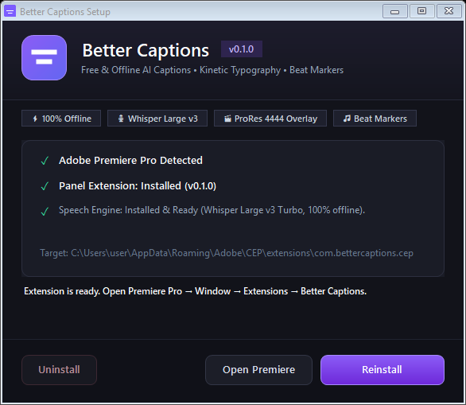

# Better Captions for Adobe Premiere Pro

<div align="center">

[](https://opensource.org/licenses/Apache-2.0)
[](https://www.adobe.com/products/premiere.html)
[](#installation)
[](#how-it-works)

**A free, 100% offline, open-source Premiere Pro extension & plugin that creates animated, highly-stylized captions, rhythm-matched beat markers, and live LUT previews directly on your timeline.**

*No subscriptions. No watermarks. No cloud API costs. No data leaves your machine.*

[Quick Start](#-quick-start--installation) • [Key Features](#-features) • [How to Use](#-step-by-step-guide) • [Architecture](#-how-it-works) • [Development](#-building-from-source)

---

</div>

## ✨ Features

### 🎙️ 1. 100% Offline AI Caption Transcription
- **Whisper Large v3 Turbo**: Local speech-to-text powered by `whisper.cpp` with high accuracy across dozens of languages.
- **Smart Speech Filtering**: Automatically skips background music, ambient noise, and silence so you don't get hallucinated subtitles.
- **Flexible Transcription Inputs**:
  - **Whole Timeline**: Captions all unmuted tracks in sync.
  - **Per-Track Speaker Separation**: Automatically colors and tags different speakers according to their audio track.
  - **Selected Timeline Clips**: Highlight clips with `Ctrl+C` / `Ctrl+V` to caption only those segments.
  - **Audio / Video Files**: Drag and drop audio or video files directly from Explorer or Premiere's Project panel.
  - **Nested Sequences**: Full nested sequence support at their exact timeline positions.

### 🎨 2. Real-Time Styling & Kinetic Animations
- **Live Canvas Preview**: Real-time rendering of your subtitles exactly as they will appear in your video.
- **Dynamic Word Highlighting (Karaoke)**: Highlight, pop, glow, or spotlight individual words precisely as they are spoken.
- **Animation Presets**: Choose from *Karaoke, Pop, Typewriter, Bounce, Drop, Elastic, Fade, Slide Up, Wave, Box, Blur In, and Spotlight* (powered by GSAP easing curves).
- **Styling Controls**: Custom typography, font sizes, weights, multi-color gradients, stroke borders, drop shadows, and customizable glow effects.
- **Custom Font Support**: Automatically detects installed system fonts (including per-user fonts) and allows custom `.ttf` / `.otf` font imports.
- **Preset Library**: Save your custom looks or export/import `.bcpreset` files to share styles across projects and editors.

### 🎬 3. One-Click Timeline Integration
- **Transparent Video Overlay (ProRes 4444)**: Renders your animated captions to an alpha-transparent video clip and inserts it straight onto your timeline above your footage.
- **Native Premiere Captions**: Export directly to standard Premiere Pro caption tracks for native editing.
- **SubRip (.SRT) & Text (.TXT)**: Export standard subtitle files with optional speaker labels and word timestamps.

### 🎵 4. Smart Beat Detection & Markers
- **Automatic Tempo Detection**: Uses the Beatroot rhythm algorithm and FFmpeg to calculate BPM with confidence ratings.
- **Automatic Color-Coded Markers**: Drops markers onto your timeline or music clip (*Red* for bar start, *Yellow* for mid-bar, *Blue* for individual beats) for fast beat-synced editing.

### 👁️ 5. Real-Time LUT Previewer
- **Live Clip Preview**: Grabs the current frame from your timeline (or original log clip) and previews your entire `.cube` LUT library as interactive thumbnails.
- **Interactive Split Screen**: Drag the split-screen slider to compare before-and-after grading in real time.
- **One-Click Apply**: Directly applies the selected look to the active clip via Lumetri Color.

---

## 🚀 Quick Start & Installation

Better Captions can be installed as a **CEP Extension** (recommended) or a **UXP Plugin**.

### Option A: 1-Click Installer for Windows (Easiest & Recommended)

<p align="center">
  
</p>

The Windows installer features a modern dark dashboard tailored for Premiere Pro editors:
- **No Admin Rights Required**: Installs directly to your user profile (`%APPDATA%`).
- **Auto-Detection**: Instantly verifies Adobe Premiere Pro installation on your system.
- **One-Time AI Setup**: Automatically fetches and unpacks the offline speech engine (~700 MB, including `whisper.cpp`, `ffmpeg`, and OpenAI's **Large v3 Turbo** model).
- **Offline Forever**: Once downloaded, all transcription works 100% offline with zero cloud dependency.

#### Steps:
1. **Close Premiere Pro.**
2. Double-click **`BetterCaptionsSetup.exe`** (or download it directly from [Releases](https://github.com/senura-d/Better-Captions-/releases/latest)).
3. Click **Install Extension**.
   > *Note:* If Windows SmartScreen displays *"Windows protected your PC"*, click **More info** → **Run anyway** (standard for open-source self-compiled executables without commercial code-signing certificates).
4. Launch Premiere Pro and open:  
   **Window → Extensions → Better Captions**

---

### Option B: Script Installer for Windows (No Admin Rights Needed)

If you prefer not to use the `.exe`, you can install the extension directly:

1. **Close Premiere Pro.**
2. Double-click **`Install Extension.bat`** (or run `install-extension.ps1` via PowerShell).
3. The script copies the extension files to `%APPDATA%\Adobe\CEP\extensions\com.bettercaptions.cep` and enables unsigned extensions (`PlayerDebugMode = 1`).
4. Open Premiere Pro and go to:  
   **Window → Extensions → Better Captions**

> To uninstall anytime, simply run **`Uninstall Extension.bat`**.

---

### Option C: UXP Plugin Installation (Creative Cloud)

If you use the Adobe Creative Cloud desktop app:
1. Double-click **`BetterCaptions.ccx`** in the repository root or download it from [Releases](https://github.com/senura-d/Better-Captions-/releases/latest).
2. Creative Cloud will prompt to install the plugin. Click **Install**.
3. In Premiere Pro, open via:  
   **Window → UXP Plugins → Better Captions**

---

### Option D: macOS Installation

1. Copy the folder `BetterCaptions-Extension/com.bettercaptions.cep` to:  
   `~/Library/Application Support/Adobe/CEP/extensions/`
2. Open Terminal and enable unsigned CEP extensions:
   ```bash
   defaults write com.adobe.CSXS.12 PlayerDebugMode 1
   ```
3. Install the offline tools via Homebrew:
   ```bash
   brew install whisper-cpp ffmpeg
   ```
4. Launch Premiere Pro and find **Better Captions** under **Window → Extensions**.

---

## 📖 Step-by-Step Guide

### Step 1: Open Your Project & The Extension
1. Launch Premiere Pro and open any project with speech or dialogue.
2. Ensure you have saved your project (files are automatically organized into a `Better Captions` folder adjacent to your `.prproj` file).
3. Open **Window → Extensions → Better Captions**.

### Step 2: Transcribe Captions
1. Click **Captions** on the home screen.
2. In the **Offline Captions** panel, select your source:
   - **Whole timeline**: Captions all active audio tracks.
   - **Scan audio tracks**: Check individual tracks or enable *Caption each track separately* for multi-speaker labeling.
   - **Selected clips**: Highlight clips in your timeline, press `Ctrl+C`, then click `Use selected timeline clips`.
   - **Audio file**: Drag an audio file from Premiere's Project panel onto the drop zone.
3. Select the spoken **Language** (or leave on auto-detect).
4. Click **Generate Captions**. The progress bar will track extraction, voice activity detection, and speech-to-text transcription.

### Step 3: Customize Style & Animation
1. **Choose a Preset**: Click any card in the **Presets** gallery to apply an instant look.
2. **Typography & Styling**:
   - Customize font family, font size, uppercase/lowercase, and letter spacing.
   - Adjust primary text color, outline stroke width, background pill, and drop shadow.
   - Toggle **Glow** to add a vibrant neon aura around words.
3. **Word Animations**:
   - Select an animation: *Karaoke*, *Pop*, *Bounce*, *Typewriter*, *Box*, or *Spotlight*.
   - In *Karaoke* or *Spotlight* mode, words illuminate sequentially in sync with speech.
4. **Save Your Look**: Click **+ Save current look** to store your configuration for future projects.

### Step 4: Add to Timeline
Choose your desired timeline output:
- **Add animated captions to timeline**: Renders your custom styled animation into a ProRes 4444 video with an alpha channel and automatically places it on the top video track aligned to the dialogue.
- **Add as editable Premiere captions**: Inserts standard native Premiere Pro subtitle clips onto a subtitle track.
- **Save SRT / TXT**: Exports standard `.srt` or `.txt` subtitle files.

---

## 🎛️ Additional Tools

### 🎵 Beat Markers
1. In the home menu, select **Beat Markers**.
2. Select your music clip or choose an audio track.
3. Click **Analyse beats** to calculate the BPM and rhythmic confidence.
4. Choose marker frequency (*Every beat*, *Every 2nd*, or *Bar starts*) and click **Add beat markers**.
5. Use `Shift+M` and `Ctrl+Shift+M` in Premiere to jump between rhythm markers.

### 👁️ LUT Preview
1. Park the playhead over any clip and select **LUT Preview**.
2. Click **Grab frame** to capture the current frame.
3. Browse installed Premiere LUTs or add custom `.cube` folders.
4. Drag the live split-screen divider to preview before-and-after color adjustments.
5. Click **Apply to selected clips** to send the look directly to Lumetri Color.

---

## 🧠 How It Works

```
Timeline Audio (Premiere Pro)
            │
            ▼
    ffmpeg Extraction (16kHz Mono WAV)
            │
            ▼
Voice Activity Detection (Silero VAD) ──► (Removes music & silences)
            │
            ▼
   whisper.cpp Engine ────────────────► (OpenAI Large v3 Turbo Model)
            │
            ▼
     Timed Word Tokens [{ word, start, end }]
            │
            ├───────────────────────────────────────────────┐
            ▼                                               ▼
   Svelte 5 / Canvas Engine                       Premiere API (.jsx)
 (Realtime Preview & Animation)               (Insert Video / Caption Track)
            │                                               │
            ▼                                               ▼
 ProRes 4444 Alpha Video Clip                    Live on Premiere Timeline!
```

---

## 🛠️ Building from Source

If you want to contribute, modify, or build the extension from scratch:

### Prerequisites
- [Node.js](https://nodejs.org/) v18 or later
- [npm](https://www.npmjs.com/) or [yarn](https://yarnpkg.com/)
- Adobe Premiere Pro v25.0+

### Clone & Install
```bash
git clone https://github.com/senura-d/Better-Captions-.git
cd Better-Captions-/Better-Captions-Premiere
npm install
cd webview-ui && npm install && cd ..
```

### Build Commands
```bash
# Build the CEP extension
npm run cep

# Build the UXP CCX package
npm run ccx

# Build the Windows installer (BetterCaptionsSetup.exe)
npm run installer
```

---

## ❓ Frequently Asked Questions (FAQ)

<details>
<summary><b>Why does Windows SmartScreen warn about the installer?</b></summary>
Windows SmartScreen displays an alert for any new executable that isn't signed with an expensive enterprise certificate. Click <b>More info → Run anyway</b>. The entire source code of the installer is available in <code>Better-Captions-Premiere/installer/Installer.cs</code> for full transparency.
</details>

<details>
<summary><b>Where are offline speech models and presets stored?</b></summary>
All offline components, models, fonts, and presets are saved locally on your machine at:
<code>%APPDATA%\BetterCaptions</code> (Windows) or <code>~/Library/Application Support/BetterCaptions</code> (macOS).
</details>

<details>
<summary><b>Can I use non-Latin or regional fonts (e.g., Sinhala, Hindi, Arabic)?</b></summary>
Yes! The transcription produces standard Unicode text. Make sure to select a Unicode-compliant font (such as Nirmala UI, Iskoola Pota, or Noto Sans) rather than legacy ASCII-encoded fonts.
</details>

---

## 📄 License & Attribution

- Released under the [Apache License 2.0](LICENSE).
- Speech transcription powered by [whisper.cpp](https://github.com/ggerganov/whisper.cpp) and [OpenAI Whisper](https://github.com/openai/whisper).
- Beat detection uses [music-tempo](https://github.com/killawhiskey/music-tempo) (Beatroot algorithm).
- Audio processing powered by [FFmpeg](https://ffmpeg.org/).
- Built upon initial concepts from Matthew Paquette's open-source Premiere project.

---

<div align="center">
<b>Developed with ❤️ for the video editing community.</b><br/>
If this tool helped your workflow, please consider starring ⭐ the repository!
</div>
